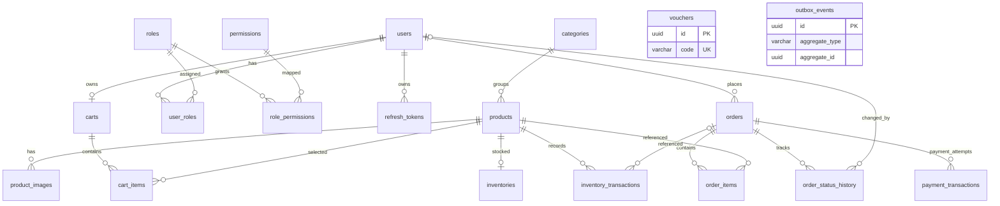
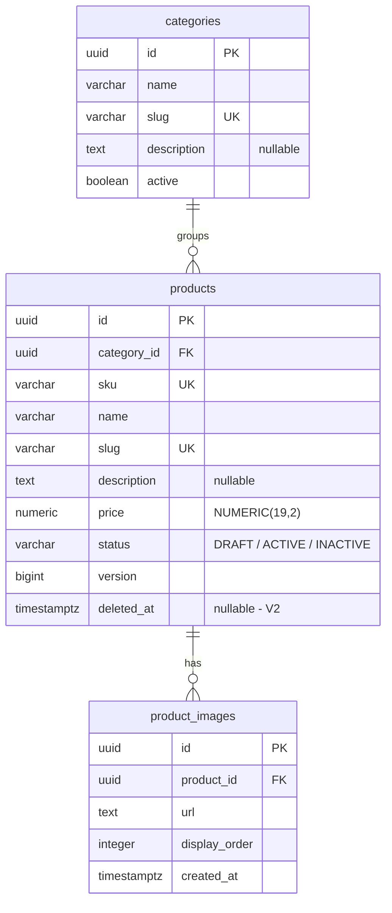
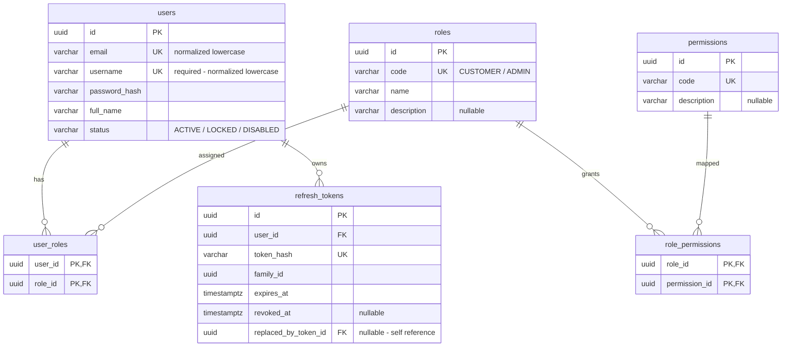
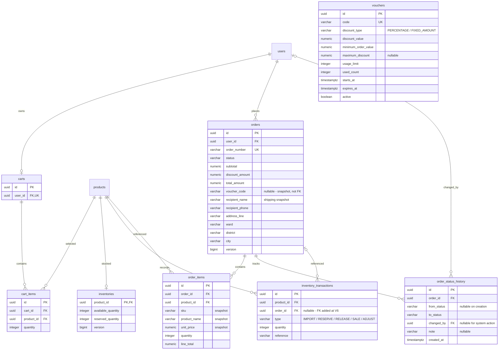
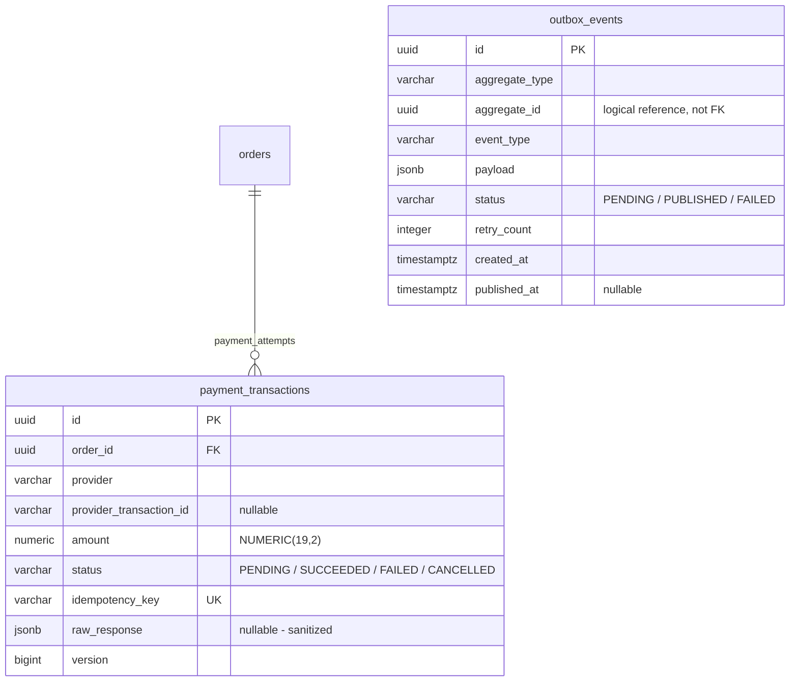

# ShopCore API — Entity relationship diagrams

Cập nhật: **2026-10-10**. Schema đã có trong repository gồm **3 bảng Catalog**, được khai báo ở V1–V2. Các bảng M2 trở đi bên dưới là thiết kế dự kiến, chưa có migration. Xem [system overview](system-overview.md) để hiểu module và luồng xử lý.

## 1. Cách đọc và phạm vi

- Tên entity trên sơ đồ là tên bảng PostgreSQL.
- `PK`: primary key; `FK`: foreign key; `UK`: unique key.
- `||` là đúng một, `o|` là không hoặc một, `o{` là không hoặc nhiều.
- Ví dụ `categories ||--o{ products`: mỗi Product thuộc đúng một Category, một Category có thể chưa có Product.
- `PK, FK` ở cùng cột có nghĩa cột vừa là primary key vừa là foreign key. Hai cột có `PK` trong bảng mapping tạo một composite primary key.
- Mermaid không biểu diễn đầy đủ nullability, composite constraints và SQL types; phần ghi chú dưới sơ đồ là một phần của thiết kế.
- Sơ đồ chi tiết chỉ liệt kê cột chính. Các bảng có timestamps theo migration/plan; việc lược bớt trên hình không có nghĩa cột không tồn tại.

## 2. Quan hệ tổng thể — kiến trúc đích

Sơ đồ này gồm cả bảng hiện có và bảng dự kiến. `vouchers` và `outbox_events` không có đường FK trong thiết kế hiện tại: Order lưu voucher code snapshot; outbox dùng aggregate reference đa kiểu.

| Nhóm | Bảng | Milestone / migration |
|---|---|---|
| Catalog | categories, products, product_images | Đã có: V1; products.deleted_at ở V2 |
| Identity/RBAC | users, roles, permissions, user_roles, role_permissions, refresh_tokens | Dự kiến M2: V3 |
| Inventory | inventories, inventory_transactions | Dự kiến M3: V4; Order FK bổ sung ở V6 |
| Cart/Voucher | carts, cart_items, vouchers | Dự kiến M4: V5 |
| Order | orders, order_items, order_status_history | Dự kiến M5: V6 |
| Payment | payment_transactions | Dự kiến M6: V7 |
| Outbox | outbox_events | Dự kiến M8: V8; M7 Redis không cần bảng riêng ở đây |

Cardinality thể hiện khả năng lưu trữ ở database. Các invariant như Order thành công phải có ít nhất một OrderItem được enforce trong checkout transaction; FK thông thường không tự đảm bảo điều đó.

## 3. Catalog — schema hiện có V1–V2

| Constraint | Thực tế trong migration |
|---|---|
| Product → Category | `category_id NOT NULL`, `ON DELETE RESTRICT` |
| Image → Product | `product_id NOT NULL`, `ON DELETE CASCADE` |
| Unique keys | categories.slug, products.sku, products.slug, `(product_id, display_order)` |
| CHECK | Name/slug/SKU/url không blank; price và display_order không âm; status hợp lệ; version không âm |
| Timestamps | categories/products có created_at và updated_at; product_images chỉ có created_at |
| Secondary indexes | Các câu CREATE INDEX cuối V1 đang comment; không coi chúng là index đã được tạo |

Category delete hiện là deactivate; Product delete dùng `deleted_at` và chuyển `INACTIVE`. Public Product phải active, chưa soft delete và thuộc Category active. Soft delete không giải phóng SKU/slug khỏi unique constraints. URL ảnh là dữ liệu liên kết; chưa có bảng file storage hoặc upload service.

## 4. Identity và RBAC — dự kiến M2 / V3

Migration dự kiến: `V3__create_identity_and_access_tables.sql`.

Không có `users.role`. User có nhiều Role; Role có nhiều Permission. Hai bảng mapping chống gán trùng bằng composite PK. Yêu cầu một User mới có role `CUSTOMER` được đảm bảo bởi transaction đăng ký.

Hai bảng `roles` và `permissions` chỉ có các cột được liệt kê trên sơ đồ, không có `created_at` hoặc `updated_at`. Entity `Role` và `Permission` tự khai báo UUID `id`, không kế thừa `BaseEntity` có auditing.

Permission dự kiến: `CATALOG_MANAGE`, `INVENTORY_READ`, `INVENTORY_MANAGE`, `VOUCHER_MANAGE`, `ORDER_READ_ALL`, `ORDER_UPDATE`, `USER_MANAGE`. Seed roles/permissions và mapping Admin bằng Flyway. Tài khoản/password Admin production không nằm trong migration.

`refresh_tokens.replaced_by_token_id` trỏ đến token kế tiếp cùng bảng; token mới nhất chưa có successor. Đây là chuỗi rotation, không phải quan hệ User–User. `family_id` dùng nhóm token; thiết kế này chưa có bảng `token_families` nên cột đó không mang `FK`.

Email và username cần unique và CHECK normalize. Username dùng `VARCHAR(50) NOT NULL`, trim/lowercase, match `^[a-z0-9_.]{3,50}$`; full_name là tên hiển thị. Register yêu cầu username và UserResponse trả username; login M2 dùng username/password. Email dành cho liên hệ và các flow xác minh/khôi phục khi được triển khai. Token hash unique; raw refresh token và access JWT không được lưu trong bảng. Index dự kiến trên user_id, family_id, expires_at của refresh_tokens. Unique constraints đã cung cấp index cho email/username/token_hash và role/permission code.

## 5. Shopping, Inventory và Order — dự kiến M3–M5

Các bảng `users`, `products` trong sơ đồ này là điểm nối đến nhóm Identity/Catalog. FK `changed_by → users.id` là đề xuất cho audit actor khi triển khai V6; migration cần chốt rõ delete policy, không làm mất lịch sử khi User bị vô hiệu hóa.

Các invariant và constraint dự kiến:

- `carts.user_id` unique: mỗi User tối đa một Cart; Cart có thể chỉ được tạo khi thêm item đầu tiên. Clear Cart xóa items, giữ Cart.
- `cart_items(cart_id, product_id)` unique; quantity lớn hơn 0. Cart không snapshot giá và không reserve inventory.
- `inventories.product_id` vừa PK vừa FK: tối đa một inventory record cho mỗi Product. Trạng thái zero-or-one cho phép Product chưa được khởi tạo inventory; policy M3 quyết định khi nào tạo record.
- Available/reserved quantity không âm; version hỗ trợ optimistic locking. InventoryTransaction ghi biến động của Product, order_id có thể null cho nhập/điều chỉnh kho.
- V4 tạo order_id trong ledger trước khi có Order; V6 mới bổ sung FK đến orders.id.
- OrderItem unique `(order_id, product_id)`; quantity dương; tiền dùng `NUMERIC(19,2)`. Bản ghi cũ hiển thị snapshot, không lấy lại giá/tên Product hiện tại.
- Order giữ snapshot địa chỉ ở các cột riêng theo implementation plan; chưa có bảng addresses.
- Voucher code trong Order là snapshot, không vẽ FK đến vouchers.code. Voucher usage chỉ tăng khi checkout commit; cần bảo vệ usage limit khi concurrent.
- `from_status` null khi tạo Order; `changed_by` null khi scheduler/system đổi trạng thái. Mỗi transition phải tạo history trong cùng transaction.

## 6. Payment và Outbox — dự kiến M6 và M8

Một Order có thể có nhiều Payment attempts; không vẽ quan hệ one-to-one chỉ vì API đọc payment có đường dẫn dạng số ít. Policy chọn payment hiện tại và retry phải được chốt ở M6.

Payment có unique idempotency_key và unique `(provider, provider_transaction_id)` cho ID không null. `provider_transaction_id` không unique độc lập giữa mọi provider. Same key/same request trả cùng kết quả; key dùng cho request khác trả conflict. Amount lấy từ Order; signature/amount/reference được kiểm tra trước khi commit trạng thái Payment/Order.

`outbox_events.aggregate_type` và `aggregate_id` có thể tham chiếu Order hoặc Payment. Không tạo một FK duy nhất cho cột đa kiểu này. Service ghi outbox cùng transaction nghiệp vụ; publisher/consumer cần retry và xử lý message trùng. Chưa có schema notification/deduplication riêng trong plan hiện tại; khi thiết kế M8, cập nhật ERD nếu thêm các bảng đó.

## 7. Đối chiếu migration và duy trì tài liệu

Schema hiện có được đối chiếu từ [V1 Catalog](../../backend/src/main/resources/db/migration/V1__create_catalog_tables.sql) và [V2 Product soft delete](../../backend/src/main/resources/db/migration/V2__add_product_soft_delete.sql). Schema dự kiến được mô tả ngay trong tài liệu này, không yêu cầu người đọc có các file plan local.

Khi thêm migration, cập nhật trạng thái bảng, cột, FK và unique constraints trong cùng commit. Nếu migration thay đổi thiết kế dự kiến, migration đã triển khai là nguồn đối chiếu chính. Không đánh dấu FK/index là đã có nếu SQL vẫn nằm trong comment hoặc chưa có migration.
