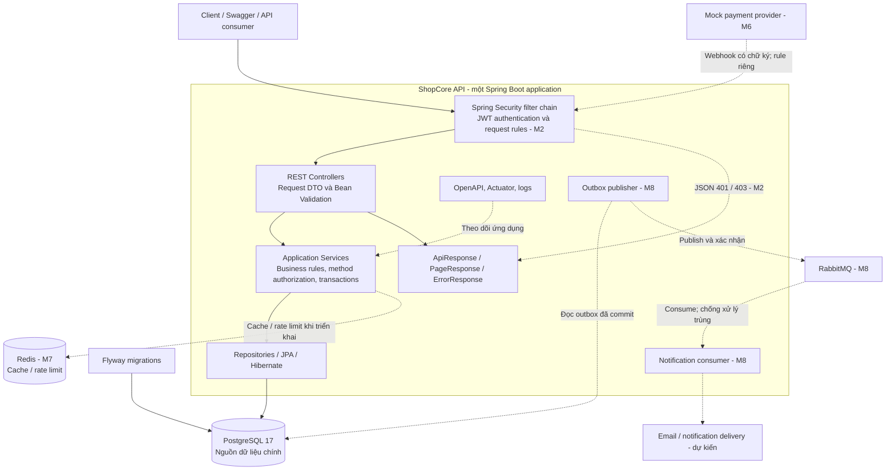
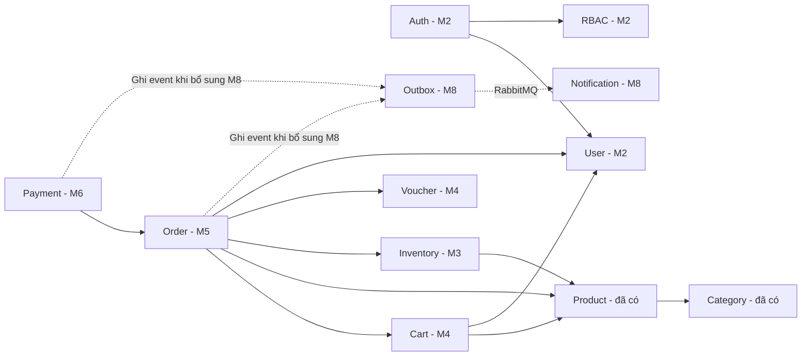
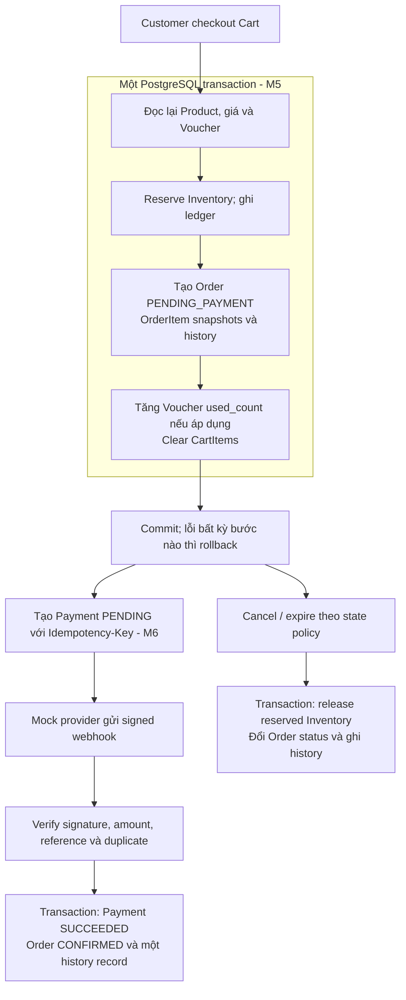

# ShopCore API — System overview

Cập nhật: **2026-10-10**. Kiến trúc: **modular monolith**, một ứng dụng Spring Boot và một PostgreSQL database. Các module nằm trong cùng process; tên module trên sơ đồ không có nghĩa là một microservice riêng.

Tài liệu này giải thích thành phần, trách nhiệm và luồng nghiệp vụ. Xem [ERD](erd.md) để biết các bảng, khóa và quan hệ dữ liệu.

## 1. Trạng thái và phạm vi

| Thành phần | Trạng thái tại thời điểm cập nhật |
|---|---|
| Category, Product, ProductImage schema | Đã có migration V1–V2 và entity |
| Category/Product API, DTO, service, repository | Đã triển khai; ProductImage chưa có flow quản trị hoàn chỉnh |
| Spring Security | Đã có filter chain, hiện đang `permitAll()`; JWT/RBAC chưa triển khai |
| PostgreSQL, Flyway, Docker Compose | Đã cấu hình; Hibernate dùng `ddl-auto=validate` |
| OpenAPI/Swagger, Actuator | Đã có; Actuator expose `health,info` |
| User, Auth, RBAC | Dự kiến Milestone 2 |
| Inventory | Dự kiến Milestone 3 |
| Cart, Voucher | Dự kiến Milestone 4 |
| Order, checkout, status history | Dự kiến Milestone 5 |
| Payment simulator, signed webhook | Dự kiến Milestone 6 |
| Redis | Dự kiến Milestone 7 |
| RabbitMQ, Outbox, Notification | Dự kiến Milestone 8 |

Milestone 1 đã có commit đóng phần triển khai. Catalog integration tests và lần chạy `clean verify` đầy đủ vẫn còn cần hoàn thành trước khi đóng Milestone 2. Sơ đồ thiết kế không phải bằng chứng các flow dự kiến đã chạy hoặc đã được test.

## 2. Kiến trúc chạy ứng dụng

Sơ đồ thể hiện kiến trúc đích. Nét liền biểu diễn đường xử lý chính; nét đứt biểu diễn phần mở rộng dự kiến. JWT/RBAC trong security layer sẽ được bổ sung ở M2.



Hiện `compose.yaml` chỉ chạy PostgreSQL. Redis và RabbitMQ chưa có trong môi trường chạy. Flyway thay đổi schema; Hibernate chỉ validate schema. Outbox publisher chủ động đọc database và gửi message, PostgreSQL không tự gửi event sang RabbitMQ.

## 3. Trách nhiệm và phụ thuộc giữa các module

Mũi tên có nghĩa là module bên trái sử dụng dữ liệu hoặc hành vi của module bên phải. Đây là phụ thuộc nghiệp vụ dự kiến, không phải sơ đồ foreign key.



| Module | Trách nhiệm |
|---|---|
| Category / Product | Danh mục, sản phẩm, giá hiện tại, trạng thái và ảnh |
| User / Auth | Hồ sơ, trạng thái tài khoản, mật khẩu, đăng nhập, JWT, refresh/logout |
| RBAC | User–Role–Permission mapping và authorities |
| Inventory | Available/reserved quantity, nhập/điều chỉnh kho, reserve/release và ledger |
| Cart | Giỏ của current user, số lượng item; chưa khóa giá và chưa giữ tồn kho |
| Voucher | Kiểm tra hiệu lực, tính giảm giá, kiểm soát số lượt dùng |
| Order | Checkout transaction, snapshot, tổng tiền, trạng thái và lịch sử |
| Payment | Payment attempt, idempotency, webhook signature và kết quả thanh toán |
| Outbox / Notification | Lưu event cùng transaction nghiệp vụ; publish/consume và gửi thông báo |
| Common / Config | Response, exception, auditing và cấu hình dùng chung |

Controller nhận request và trả DTO. Service xác định transaction boundary. Repository truy cập dữ liệu. Khi các module có thêm hành vi, ưu tiên gọi service của module sở hữu nghiệp vụ để giữ rule ở một nơi. Code Catalog hiện vẫn truy cập `CategoryRepository` từ `ProductServiceImpl`.

## 4. Authentication và authorization — M2

```mermaid
sequenceDiagram
    participant C as Client
    participant A as Auth service
    participant D as PostgreSQL
    participant S as Spring Security
    participant B as Business service
    C->>A: Login bằng username/password
    A->>D: Tìm User theo username; load Roles và Permissions
    A->>A: Check password và User status
    A->>D: Lưu refresh token hash và family_id
    A-->>C: Access JWT + raw refresh token
    C->>S: Protected API với Bearer JWT
    S->>S: Validate signature, issuer, audience, exp/nbf
    S->>S: Map roles/permissions; check request rule
    S->>B: Current user và authorities
    B->>B: Check method permission và ownership nếu cần
    B-->>C: Response DTO
```

Register luôn gán `CUSTOMER`; client không được chọn role. Role `ADMIN` map thành `ROLE_ADMIN`; permission như `CATALOG_MANAGE` giữ nguyên code. Theo plan M2, `/api/v1/admin/**` cần `ROLE_ADMIN`, và nghiệp vụ bên trong cần permission tương ứng. Nếu sau này có role nhân viên, cần cập nhật rule đường dẫn để nhân viên có permission phù hợp truy cập được.

Register yêu cầu email, username, password và fullName. Username unique, được trim/lowercase và giới hạn 3–50 ký tự chữ ASCII, số, `_` hoặc `.`. UserResponse có username; fullName là tên hiển thị. Login M2 dùng username/password; username được normalize nhất quán với Register, password giữ nguyên. Sai username/password trả thông báo chung `Invalid username or password`. Email vẫn bắt buộc, unique và dành cho liên hệ cùng các flow xác minh/khôi phục khi được triển khai.

RBAC xác định hành động được phép; ownership xác định resource của ai. Customer có quyền gọi Order API vẫn chỉ được đọc/hủy Order của chính mình. Webhook M6 cần rule riêng để provider gửi request bằng signature, không yêu cầu Customer JWT.

Refresh token là chuỗi ngẫu nhiên; database chỉ lưu hash. Rotation cần lock/atomic update và transaction; reuse token cũ phải được phát hiện theo token family. Khi trả lỗi reuse, thay đổi revoke family phải được commit, không bị rollback theo exception. Client phải tránh gửi refresh song song; policy nghiêm ngặt có thể coi request thứ hai là reuse và revoke family vừa rotate.

Access token có TTL ngắn, ví dụ 15 phút. Logout/revoke refresh token không lập tức vô hiệu hóa access JWT. Quyền và trạng thái tài khoản thay đổi có thể chưa phản ánh trong JWT cũ tới khi hết hạn nếu không có kiểm tra trạng thái bổ sung. Login/refresh phải kiểm tra trạng thái tài khoản và lấy lại quyền hiện tại.

## 5. Checkout và payment — M5–M6



Giá trong Cart chỉ để tham khảo; OrderItem lưu snapshot giá/tên/SKU tại checkout. Payment amount lấy từ Order, không lấy tùy ý từ client. Unique constraints và locking/version bảo vệ request đồng thời và webhook lặp.

Plan còn cần chốt thời điểm chuyển inventory từ `RESERVE` sang `SALE`, quy tắc retry sau payment failure và việc cancel sau xác nhận. Khi triển khai M5–M6, các quyết định này phải thống nhất với Order state machine và expiry scheduler.

## 6. Mở rộng bằng Redis và Outbox — M7–M8

Redis dùng cho cache hoặc dữ liệu TTL, PostgreSQL vẫn quyết định đơn hàng, thanh toán và tồn kho. Cache phải có policy invalidation khi thay đổi dữ liệu; chưa chuyển Cart sang Redis trong thiết kế ban đầu.

Ở M8, service ghi business data và `outbox_events` trong cùng transaction. Publisher gửi event đã commit đến RabbitMQ, sau đó cập nhật trạng thái outbox. Có thể gửi trùng khi crash/retry; consumer cần idempotency. Thông báo chạy sau transaction đặt hàng/thanh toán, không giữ database transaction mở trong khi gửi email.

## 7. Nguồn đối chiếu và cách cập nhật

Các tài liệu kiến trúc tự chứa nội dung thiết kế; người clone repo không cần hai file plan cá nhân. Những phần `dự kiến` được chuyển sang `đã triển khai` sau khi code và migration tương ứng tồn tại.

- Schema đã có: [V1 Catalog](../../backend/src/main/resources/db/migration/V1__create_catalog_tables.sql), [V2 soft delete](../../backend/src/main/resources/db/migration/V2__add_product_soft_delete.sql).
- Security hiện tại: [SecurityConfig.java](../../backend/src/main/java/io/github/datnguyen2810/shopcore/config/SecurityConfig.java).
- Runtime local: [compose.yaml](../../backend/compose.yaml), [application.yml](../../backend/src/main/resources/application.yml).
- Quan hệ dữ liệu: [erd.md](erd.md).

Mỗi migration/feature thay đổi schema hoặc boundary nghiệp vụ cần cập nhật sơ đồ trong cùng commit. Ngày cập nhật thể hiện lúc đối chiếu tài liệu, không đảm bảo mô tả trạng thái một database đang chạy.
